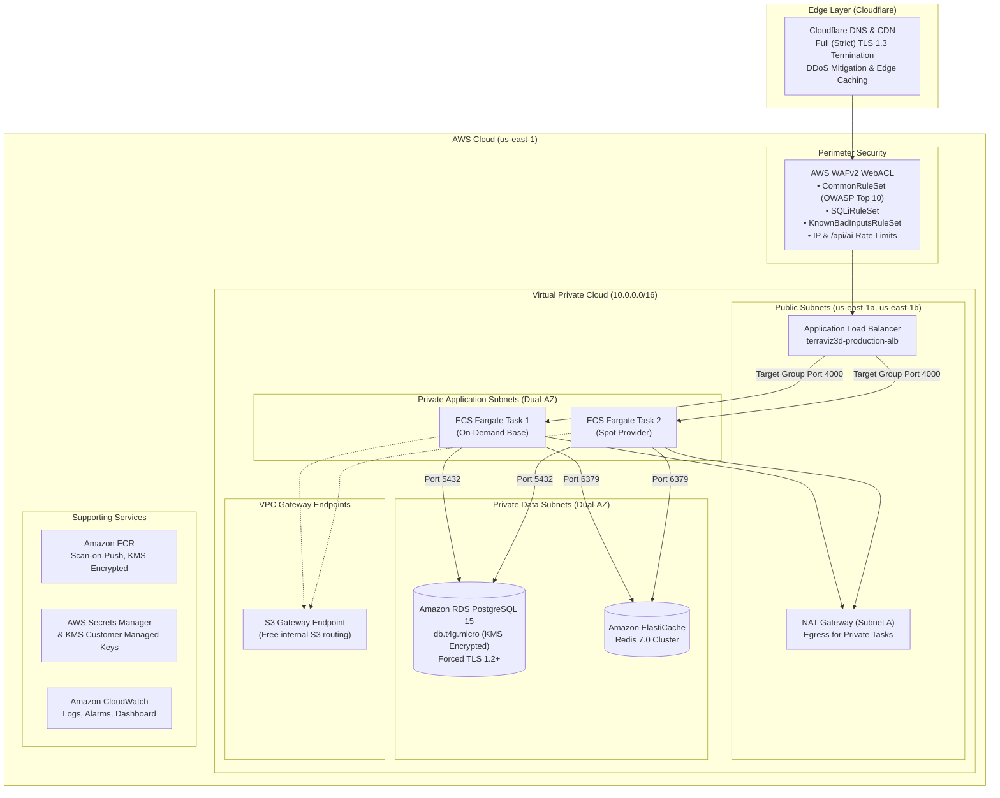
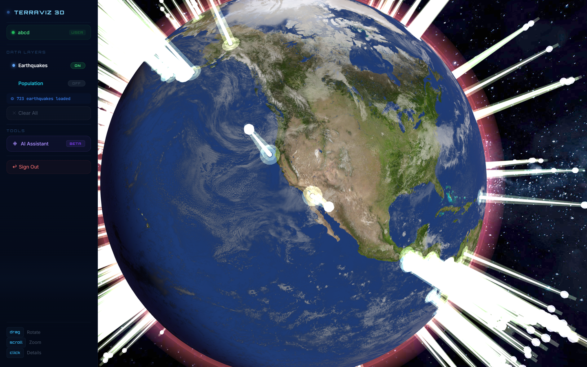
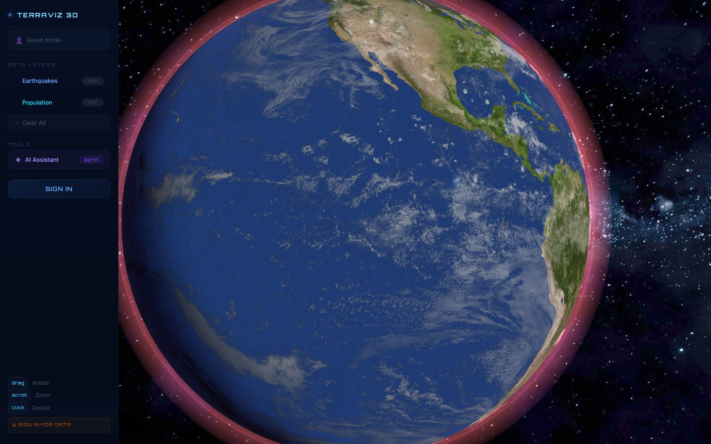
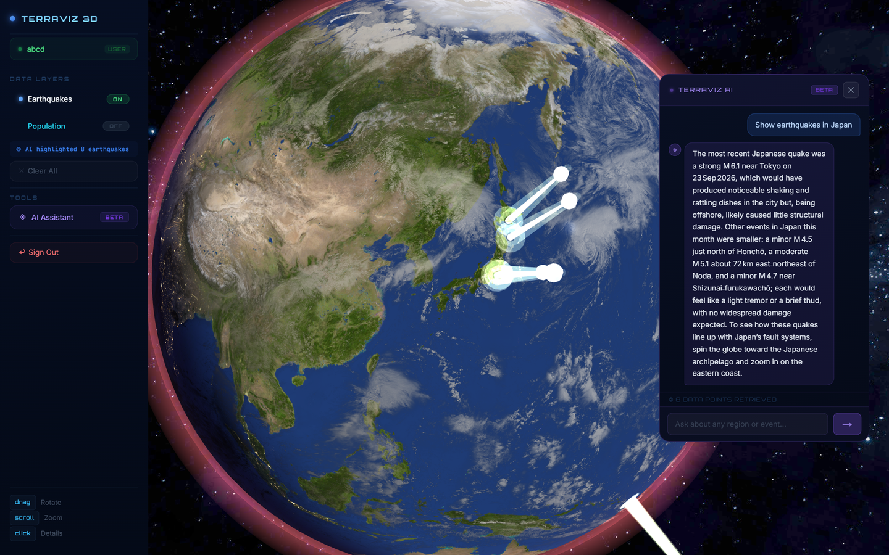
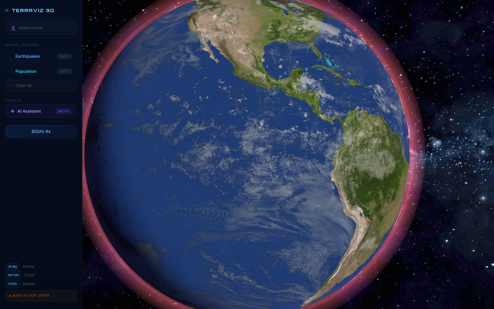
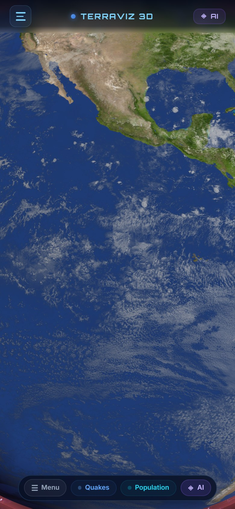

# TerraViz 3D — Geospatial Intelligence Platform

TerraViz 3D is a full-stack, cloud-native geospatial intelligence platform deployed on Amazon Web Services (AWS) and served globally through Cloudflare. The platform renders a hardware-accelerated 3D globe in the browser, visualizes real-time seismic feeds and demographic data, and features a specialized Graph-RAG AI assistant that interprets geospatial activity and guides user exploration.

The infrastructure is automated using Terraform (Infrastructure as Code) following multi-tier, zero-trust cloud architecture principles across two AWS Availability Zones.

- **Production URL:** https://terraviz.anmolcloud.in
- **Cloud Provider:** Amazon Web Services (AWS)
- **Deployment Region:** us-east-1 (High Availability across 2 Availability Zones)
- **Edge Routing & Security:** Cloudflare
- **Demo Credentials:**
  - **Username:** `abcd`
  - **Password:** `abcdef`

---

## Cloud Architecture



### Cloud Infrastructure Components

| Service | Role | Configuration Details |
| :--- | :--- | :--- |
| **Cloudflare** | Edge DNS, CDN, & SSL | CNAME proxying to AWS ALB; Full (Strict) SSL/TLS encryption; HTTP/2 and HTTP/3 support; DDoS mitigation. |
| **AWS WAFv2** | Application Firewall | Attached to ALB; enforces `CommonRuleSet`, `SQLiRuleSet`, `KnownBadInputsRuleSet`, and rate limits on API and AI endpoints. |
| **AWS ALB** | Load Balancing | Dual-AZ public Application Load Balancer with health checks on `/health` and zero-downtime rolling connection draining. |
| **AWS ECS Fargate** | Compute Tier | Multi-AZ containerized service (`terraviz3d-cluster-production`) running 2 tasks (On-Demand + Spot mix) with 70% CPU target tracking auto-scaling. |
| **Amazon ECR** | Container Registry | Private repository with KMS encryption, scan-on-push vulnerability scanning, and lifecycle rules retaining the last 5 images. |
| **Amazon RDS** | Relational Database | PostgreSQL 15 on `db.t4g.micro` across private DB subnets; KMS customer-managed key encryption; deletion protection; forced TLS 1.2+. |
| **Amazon ElastiCache** | In-Memory Cache | Redis 7.0 cluster in private subnets for session caching and external API buffering. |
| **AWS Secrets Manager & KMS** | Secret & Key Management | Customer Managed Keys (`alias/terraviz3d-data`, `alias/terraviz3d-logs`) and centralized secret storage for credentials. |
| **Amazon CloudWatch** | Observability | Container log streaming with 30-day retention; operational metric dashboard; alarms for CPU, memory, 5xx errors, and DB connections. |
| **Terraform** | Infrastructure as Code | Modularized root configuration (`network`, `compute`, `data`, `security`, `monitoring`, `iam`) with remote S3 backend and DynamoDB locking. |

---

## TerraViz Website Services

### 1. 3D Globe & Real-Time Earthquake Monitoring Service
The primary visualization service renders an interactive WebGL Earth featuring custom GLSL atmosphere shaders, bump-mapped terrain topography, dynamic cloud rotation, and starfield rendering. 

The service ingests the live USGS M4.5+ earthquake stream over a 30-day window, converts latitude/longitude coordinates into 3D Cartesian coordinates, and renders each event as an illuminated, magnitude-scaled cylinder. Selecting any marker displays comprehensive seismic metadata including magnitude, depth, recording time, and tsunami flags.



---

### 2. Global Population Intelligence Service
The demographic visualization service provides worldwide population density mapping across 195+ sovereign nations. Country metrics are retrieved via the backend proxy caching layer and mapped to 3D logarithmic pillar extrusions at national geographic centroids, allowing visual correlation between human population concentrations and active tectonic boundary lines.



---

### 3. AI Geospatial Assistant Service (TerraViz AI)
The platform includes an AI seismologist assistant built directly into the 3D globe interface. Rather than returning raw database records, the assistant evaluates seismic context and translates technical parameters into real-world meaning (such as structural shaking intensity and tsunami risk) while actively directing the user where to inspect on the globe.

#### Hybrid Graph-RAG Architecture
1. **Preprocessing & Embedding:** Real-time GeoJSON seismic events are parsed into standardized descriptions, embedded into 384-dimensional vectors using `@xenova/transformers` (`all-MiniLM-L6-v2`), and indexed into PostgreSQL.
2. **Knowledge Graph Expansion:** Semantic edges (`rag_edges`) link events sharing regional tectonic faults, temporal 7-day windows, and similar magnitude thresholds.
3. **Hybrid 3-Stage Retrieval:** Queries are resolved through vector cosine similarity search, PostgreSQL `pg_trgm` full-text search, and graph edge traversal, combined using Reciprocal Rank Fusion (RRF).
4. **Answer-First Inference:** Context is processed via Groq (`openai/gpt-oss-20b`) enforcing conclusion-first responses, register matching, and automated globe marker focus.



---

### 4. User Authentication & Access Control Service
The authentication service provides identity management and session isolation:
- **Demo Access:** Pre-configured demo account available for live evaluation — Username: `abcd`, Password: `abcdef`.
- **Stateless Tokens:** JSON Web Tokens (JWT) signed with HMAC-SHA256, transmitted in `HttpOnly`, `SameSite=Lax` cookies and Bearer headers.
- **Credential Security:** Passwords hashed with `bcryptjs` and salt rounds.
- **Brute Force Protection:** Automatic account lockout after 5 consecutive failed login attempts (15-minute lockout period).
- **Audit Logging:** Every authentication and security event is permanently written to an append-only `audit_logs` table in PostgreSQL.



---

### 5. Mobile Responsive Interface Service
The application includes a touch-optimized mobile experience designed for smartphones and tablets:
- **Adaptive Frustum Fitting:** Dynamically calculates camera distance based on viewport aspect ratio so the globe boundaries fit cleanly within mobile portrait screens with side margins on initial load.
- **Touch Gestures:** Native 1-finger orbit rotation, 2-finger pinch-to-zoom (clamped between 1.2x and 14.0x radius), and touch-tap marker selection with `touch-action: none` isolation.
- **Ergonomic Navigation:** Compact mobile top bar, off-canvas slide-out drawer, floating bottom quick-actions dock, and draggable bottom sheets for the AI assistant and event inspector.



---

## Technology Stack

### Frontend
- **Framework:** React 19, Vite 8
- **3D Graphics:** Three.js (WebGL), Custom GLSL Shaders
- **Typography & Styling:** Orbitron, Inter, JetBrains Mono, Custom CSS Modules
- **State Management:** Custom React Hooks (`useAuth`, `useIsMobile`)

### Backend
- **Runtime:** Node.js 22 LTS, Express 4.18
- **Database:** PostgreSQL 15 (`pg`), pg_trgm extension
- **ML & Embeddings:** `@xenova/transformers` (`all-MiniLM-L6-v2`)
- **LLM Inference:** Groq SDK (`openai/gpt-oss-20b`)
- **Security:** Helmet, CORS, bcryptjs, jsonwebtoken, cookie-parser, express-rate-limit

### Cloud & DevOps
- **Cloud Provider:** Amazon Web Services (AWS)
- **Edge / CDN:** Cloudflare (DNS, SSL/TLS Termination, Caching)
- **Infrastructure as Code:** Terraform
- **Containerization:** Docker (Multi-stage Debian minimal build)
- **Container Registry:** Amazon ECR
- **Container Orchestration:** AWS ECS Fargate
- **Load Balancing:** AWS Application Load Balancer (ALB)
- **Database Service:** Amazon RDS PostgreSQL
- **Security:** AWS WAFv2, AWS Secrets Manager, AWS KMS
- **Observability:** AWS CloudWatch Logs, Metrics, Alarms, Dashboard

---

## Repository Structure

```text
Terraviz3D/
├── backend/
│   ├── public/              # Production static assets served by backend container
│   ├── src/
│   │   ├── config/          # Database pool and environment configuration
│   │   ├── controllers/     # AI, Auth, and Geo controllers
│   │   ├── middleware/      # Auth, rate limiting, and error handling
│   │   ├── routes/          # API route definitions
│   │   ├── services/        # RAG, graph, embedding, and geo services
│   │   ├── tests/           # Automated prompt benchmarks and evaluation suites
│   │   └── server.js        # Express application entrypoint
│   ├── Dockerfile           # Multi-stage production container build
│   └── package.json
│
├── frontend/
│   ├── public/              # Globe textures and icons
│   ├── src/
│   │   ├── components/      # GlobeEngine.js, AIChatpanel.jsx, AuthModal.jsx
│   │   ├── hooks/           # useAuth.js, useIsMobile.js
│   │   ├── services/        # Client API interfaces
│   │   ├── App.jsx          # Main application orchestrator
│   │   └── main.jsx         # React entrypoint
│   ├── index.html           # Viewport configuration and web app manifests
│   └── vite.config.js       # Build and development proxy configuration
│
├── terraform/
│   ├── bootstrap/           # Remote state S3 bucket and DynamoDB lock table
│   ├── environments/prod/   # Production root configuration and backend state
│   ├── modules/
│   │   ├── compute/         # ALB, ECS Fargate, ECR definitions
│   │   ├── data/            # RDS PostgreSQL and ElastiCache definitions
│   │   ├── iam/             # Roles, boundaries, and policies
│   │   ├── monitoring/      # CloudWatch log groups, alarms, and dashboards
│   │   ├── network/         # VPC, subnets, NAT Gateway, route tables
│   │   └── security/        # WAFv2, KMS keys, Secrets Manager
│   ├── builder-user-data.sh # Self-terminating EC2 container builder script
│   └── pack.py              # Deployment bundling utility
│
├── docs/
│   └── screenshots/         # Real screenshots of TerraViz website services
│
└── README.md
```

---

## Local Development Setup

### Prerequisites
- Node.js >= 20.x
- PostgreSQL >= 14.x
- Groq API Key

### 1. Database Configuration
Create a local PostgreSQL database named `terraviz`:
```sql
CREATE DATABASE terraviz;
```

### 2. Backend Setup
Create `backend/.env`:
```env
PORT=4000
NODE_ENV=development
DB_HOST=localhost
DB_PORT=5432
DB_NAME=terraviz
DB_USER=postgres
DB_PASSWORD=your_local_password
JWT_SECRET=your_development_secret_key_minimum_32_characters
JWT_EXPIRES=2h
FRONTEND_URL=http://localhost:5173
GROQ_API_KEY=your_groq_api_key
```

Install dependencies and start the backend service:
```bash
cd backend
npm install
npm run dev
```

### 3. Frontend Setup
In a new terminal window:
```bash
cd frontend
npm install
npm run dev
```
Access the application at `http://localhost:5173`.

---

## Production Deployment Workflow

### 1. Frontend Build
Compile the client assets and copy them into the backend container serving directory:
```bash
cd frontend
npm run build
cp -r dist/* ../backend/public/
```

### 2. Container Build & Push (Amazon ECR)
Authenticate Docker with your AWS account and build the container:
```bash
aws ecr get-login-password --region us-east-1 | docker login --username AWS --password-stdin 530540751051.dkr.ecr.us-east-1.amazonaws.com

docker build -t 530540751051.dkr.ecr.us-east-1.amazonaws.com/terraviz-backend:latest -f backend/Dockerfile backend

docker push 530540751051.dkr.ecr.us-east-1.amazonaws.com/terraviz-backend:latest
```

### 3. Rolling Service Update (AWS ECS)
Trigger zero-downtime container replacement on the ECS cluster:
```bash
aws ecs update-service \
  --cluster terraviz3d-cluster-production \
  --service terraviz3d-backend-svc \
  --force-new-deployment \
  --region us-east-1
```
